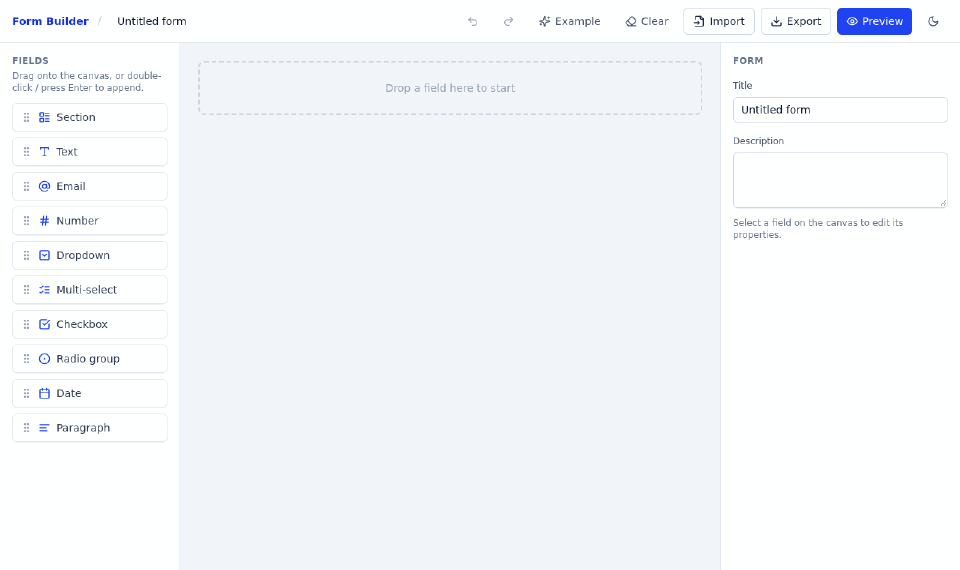
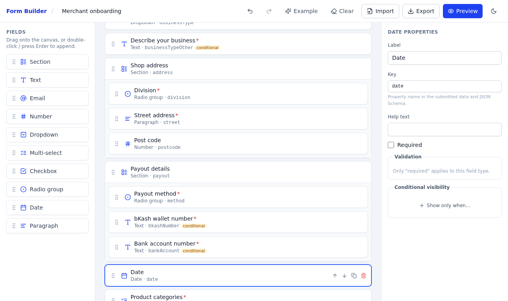
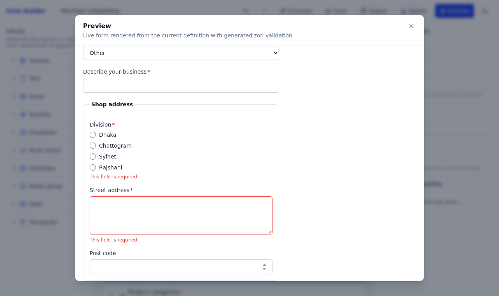
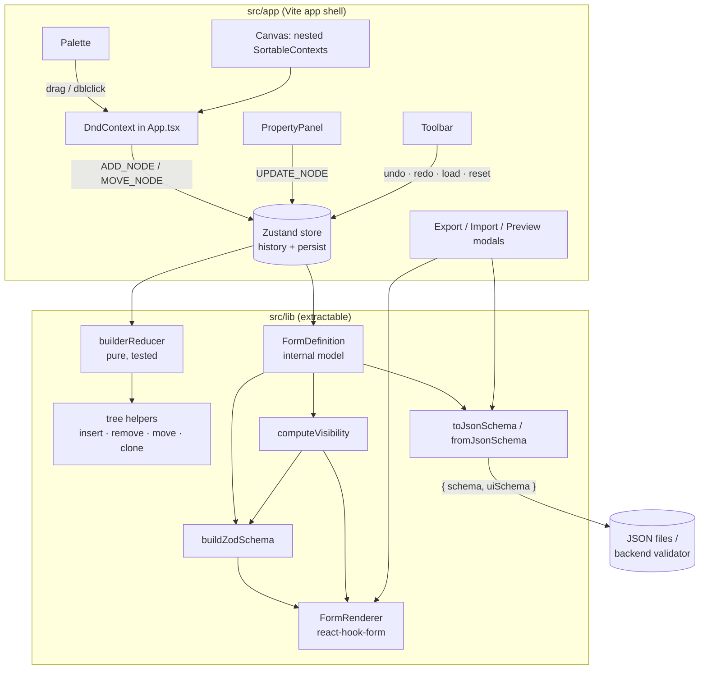

<!-- topics: react,typescript,drag-and-drop,dnd-kit,json-schema,zod,react-hook-form,form-builder,vite -->
# React Form Builder

Drag-and-drop form builder that exports JSON Schema draft-07 plus a UI schema, imports them back, and renders working forms with react-hook-form and zod validation generated from the schema.

[](https://github.com/AkibUllah/react-form-builder/actions/workflows/ci.yml)
[](https://github.com/AkibUllah/react-form-builder/actions/workflows/codeql.yml)
[](https://github.com/AkibUllah/react-form-builder/releases)


[](LICENSE)

## Try it live

| | |
|---|---|
| Live demo | https://akibullah.github.io/react-form-builder/ — the real builder; click **Example** in the toolbar to load the merchant-onboarding form, then **Preview** |
| Run in your browser | [](https://codespaces.new/AkibUllah/react-form-builder?quickstart=1) — installs dependencies and starts the Vite dev server; open the forwarded port 5174 ("Form Builder") |
| One-click deploy | [](https://render.com/deploy?repo=https://github.com/AkibUllah/react-form-builder) — nginx image from the Dockerfile, health check on `/healthz` |
| Local | `npm ci && npm run dev` or `docker build -t form-builder . && docker run -p 8080:80 form-builder` (see Quick Start) |

## Screenshots



*Live demo: load the example form, drag a Date field in, preview with generated validation, then export the JSON Schema.*



*Builder: palette, nested sections on the canvas (conditional fields are tagged) and the property panel for the selected field.*



*Preview: zod validation generated from the definition; choosing "Other" reveals the conditional "Describe your business" field.*

## Why this exists

KYC onboarding, merchant registration, field-survey and loan-application products all need forms that operations teams change weekly, and every change used to be a frontend ticket. The fix is a form definition that non-engineers can edit and that the product renders directly. This repository is that pipeline end to end: a builder for the definition, a lossless export to standard JSON Schema (so backends can validate the same payload with any draft-07 validator), and a renderer that turns the definition into a validated React form with conditional fields. The `src/lib` folder has no dependency on the app shell and is written to be lifted into a package.

## Features

- Palette of ten node types: text, email, number, dropdown, multi-select, checkbox, radio group, date, paragraph and section (sections nest).
- Drag from the palette onto the canvas or into a section; reorder and move between sections with dnd-kit (pointer and keyboard sensors); up/down/duplicate/delete buttons as a no-drag alternative.
- Property panel: label, key (auto-camelCased and kept unique), placeholder, help text, required, option editor, per-type validation (min/max length, numeric range, min/max selections, regex with custom message).
- Conditional visibility rules (`equals`, `notEquals`, `contains`, `isEmpty`, `isNotEmpty`, `greaterThan`, `lessThan`) on fields and whole sections; hidden fields are excluded from validation and from the submitted payload.
- Export to JSON Schema draft-07 (types, formats, enum, nested objects, required lists) plus a UI schema with react-jsonschema-form style keys (`ui:widget`, `ui:placeholder`, `ui:help`, `ui:order`, `ui:condition`); copy or download.
- Import either the combined document or any plain draft-07 object schema; the example form round-trips byte-for-byte.
- `FormRenderer` component: react-hook-form + zod schema generated from the definition, live conditional fields, accessible labels/errors.
- Preview modal with the rendered form and the submitted JSON side by side.
- Undo/redo (50 steps, Ctrl+Z / Ctrl+Shift+Z), autosaved draft in `localStorage`, dark mode, responsive three-pane layout.
- 40 Vitest tests, strict TypeScript, ESLint, CI on Node 18/20, nginx Dockerfile.

## Architecture



Design decisions:

- **One internal model, two derived formats.** The builder edits `FormDefinition`; JSON Schema and zod are both derived from it. That keeps JSON Schema export lossless (anything draft-07 cannot express, like widgets and conditions, goes to the UI schema) and lets the renderer validate exactly what the backend will validate.
- **Pure reducer under a thin store.** All structural edits go through `builderReducer`, which is unit-tested without React. The Zustand store adds undo/redo and persistence, and only structural actions create history entries.
- **Required-ness is evaluated with visibility.** Field types/constraints are ordinary zod rules; "required" lives in a `superRefine` that first computes which nodes are visible for the submitted data, so a required field hidden by a condition never blocks submission, and stale values of hidden fields are stripped from the payload.
- **Move semantics match dnd-kit.** `MOVE_NODE` is "remove, then insert at index", identical to `arrayMove`, so a drop onto a node takes that node's position whether moving up, down or across sections. Sections cannot be dropped into themselves.
- **Keys are stable identifiers.** Labels are turned into camelCase keys and made unique on creation and on edit; the importer preserves existing identifiers verbatim so round trips do not rename anything.

## Tech Stack

| Area | Choice |
| --- | --- |
| UI | React 18.3, TypeScript 5.4 (strict), Tailwind CSS 3.4, lucide-react |
| Drag and drop | @dnd-kit/core 6, @dnd-kit/sortable 8 |
| Forms | react-hook-form 7, zod 3, @hookform/resolvers |
| State | Zustand 4 (`persist`), pure reducer |
| Schema | JSON Schema draft-07 + UI schema (rjsf-style keys) |
| Tooling | Vite 5, Vitest 1, Testing Library, ESLint 8 |
| Delivery | GitHub Actions (Node 18/20), nginx Docker image |

## Quick Start

Local:

```bash
git clone git@github.com:AkibUllah/react-form-builder.git
cd react-form-builder
npm ci
npm run dev        # http://localhost:5174
```

Click **Example** in the toolbar to load a merchant-onboarding form with sections, regex-validated BD phone numbers and conditional payout fields, then **Preview** to submit it.

Docker:

```bash
docker build -t form-builder .
docker run --rm -p 8080:80 form-builder
# http://localhost:8080 · health: /healthz
```

## Usage

Using the library pieces directly (everything is exported from `src/lib/index.ts`):

```tsx
import { FormRenderer, toJsonSchema, fromJsonSchema, buildZodSchema } from '@/lib';
import type { FormDefinition } from '@/lib';

const definition: FormDefinition = {
  version: 1,
  id: 'contact',
  title: 'Contact us',
  nodes: [
    { id: 'n1', type: 'text', key: 'name', label: 'Name', required: true, validation: { minLength: 2 }, options: [] },
    { id: 'n2', type: 'select', key: 'topic', label: 'Topic', required: true, validation: {},
      options: [{ label: 'Billing', value: 'billing' }, { label: 'Other', value: 'other' }] },
    { id: 'n3', type: 'textarea', key: 'details', label: 'Details', required: true, validation: {}, options: [],
      visibleWhen: { fieldKey: 'topic', operator: 'equals', value: 'other' } },
  ],
};

// Render it
<FormRenderer definition={definition} onSubmit={(values) => console.log(values)} />;

// Export for the backend
const { schema, uiSchema } = toJsonSchema(definition);
// schema.properties.name -> { type: 'string', title: 'Name', minLength: 2 }
// schema.required        -> ['name', 'topic']
// uiSchema.details       -> { 'ui:widget': 'textarea', 'ui:condition': { fieldKey: 'topic', operator: 'equals', value: 'other' } }

// Validate on the server (or anywhere) with the same rules
const result = buildZodSchema(definition).safeParse({ name: 'A', topic: 'billing' });
// result.success === false, issue at ['name']: "Must be at least 2 characters"

// Import an existing schema
const imported = fromJsonSchema(schema, uiSchema);
```

Export format at a glance:

| Field type | JSON Schema | UI schema |
| --- | --- | --- |
| text / textarea | `string` + `minLength` / `maxLength` / `pattern` | `ui:widget: textarea` for paragraphs, `ui:patternMessage` |
| email | `string`, `format: email` | `ui:widget: email` |
| date | `string`, `format: date` | `ui:widget: date` |
| number | `number` + `minimum` / `maximum` | |
| checkbox | `boolean` | `ui:widget: checkbox` |
| select / radio | `string` + `enum` (+ `x-options` labels) | `ui:widget: select` / `radio` |
| multiselect | `array` of `enum`, `uniqueItems`, `minItems` / `maxItems` | `ui:widget: checkboxes` |
| section | `object` with `properties` / `required` | nested UI schema with its own `ui:order` |

Reducer actions (`dispatch` from `useBuilderStore`): `ADD_NODE`, `MOVE_NODE`, `REMOVE_NODE`, `DUPLICATE_NODE`, `UPDATE_NODE`, `SELECT`, `UPDATE_FORM`, `LOAD`, `RESET`.

## Project Structure

```
react-form-builder/
├── src/
│   ├── lib/                       # framework-agnostic core (extractable)
│   │   ├── types.ts               # FormDefinition, FieldNode, SectionNode, ConditionRule
│   │   ├── ids.ts                 # createId, slugifyKey, normalizeKey, uniqueKey
│   │   ├── tree/                  # walk, find, insert, remove, update, clone
│   │   ├── rules/conditions.ts    # evaluateCondition, computeVisibility
│   │   ├── store/reducer.ts       # builderReducer (pure)
│   │   ├── store/useBuilderStore.ts # Zustand + undo/redo + persist
│   │   ├── schema/jsonSchema.ts   # toJsonSchema, fromJsonSchema, parseExportedJson
│   │   ├── schema/zod.ts          # buildZodSchema, defaultValues, stripHidden
│   │   ├── renderer/FormRenderer.tsx
│   │   └── renderer/fields/FieldControl.tsx
│   ├── app/                       # Vite app shell
│   │   ├── App.tsx                # DndContext, drop resolution, layout
│   │   ├── example.ts             # merchant onboarding sample form
│   │   └── components/            # Palette, Canvas, PropertyPanel, Toolbar, modals
│   ├── test/setup.ts
│   └── main.tsx
├── Dockerfile · nginx.conf
└── .github/workflows/ci.yml
```

## Testing

```bash
npm test          # vitest run
npm run lint      # eslint + tsc --noEmit
npm run build     # tsc + vite build
```

40 tests across 8 files:

- `tree` – flatten/find/descendant checks, immutable insert/remove/update, key slugging and uniqueness.
- `store/reducer` – add with unique keys, arrayMove-style reorder, cross-section moves, self-drop guard, remove with selection cleanup, deep duplicate, key normalisation, load/reset.
- `store` – undo/redo history semantics and persisted shape.
- `rules/conditions` – every operator, nested flattening, hidden-section propagation, hidden-field-as-empty.
- `schema/jsonSchema` – type/format/constraint mapping, nested sections, UI schema content, export→import→export round trip, plain third-party schema import, error cases.
- `schema/zod` – coercion, nested required, conditional required, every constraint message, default values, payload stripping.
- `FormRenderer` – rendering, validation errors, live conditional fields and a full submit with a clean payload.
- `App` – palette → canvas → property panel → export flow, undo/redo, canvas controls.

## Roadmap

- [ ] `oneOf`/`dependencies` emission so conditions are also expressed in pure JSON Schema for validators that support it (#1)
- [ ] Field types: file upload, phone (with `bangla-i18n` BD validation), signature, repeating groups (#2)
- [ ] Multi-page forms with progress and per-page validation (#3)
- [ ] Theming hooks for `FormRenderer` so host apps can supply their own inputs (#4)
- [ ] Publish `src/lib` as `@akibullah/form-builder-core` (#5)

## License

MIT, see [LICENSE](LICENSE).
